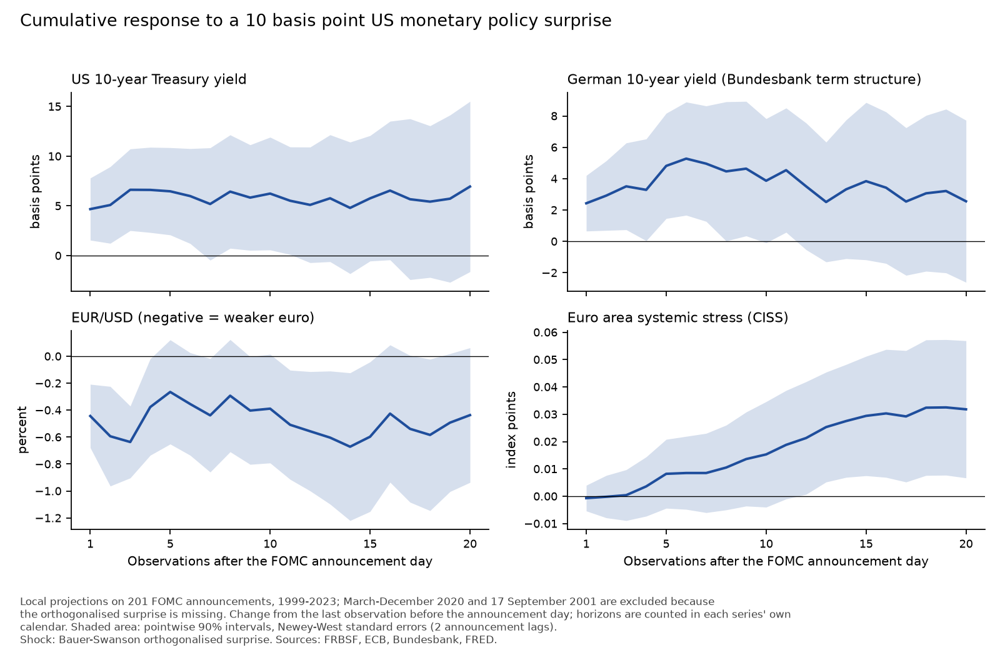

# Global Markets & Spillover Monitor

How much does a Fed surprise move euro area markets? This repository measures
the reaction of German and US 10-year yields, the euro-dollar exchange rate and
euro area financial stress in the days after each FOMC announcement from 1999
to 2023. Everything runs from public data, and one command rebuilds every table
and figure from the raw files.

The project has three outputs: the event study below, a two-page
[policy note](note/policy_note.md) on its results, and a
[monitor](outputs/monitor/monitor.md) of where exchange rates, yields, oil and
financial stress stand today.

## Main result



A 10 basis point tightening surprise by the Fed raises the US 10-year yield by
about 4.7 basis points over the window that ends at the first observation after
the announcement (h = 1). The German 10-year yield rises by about 2.4, roughly
half as much, and the euro loses 0.44% against the dollar. Euro area systemic
stress (the ECB's CISS) shows no statistically detectable response at the main
horizons.

| Response to a 10 bp surprise | h = 1 | h = 2 | h = 5 |
| --- | ---: | ---: | ---: |
| US 10-year yield (bp) | 4.68 | 5.09 | 6.47 |
| German 10-year yield (bp) | 2.43 | 2.92 | 4.81 |
| EUR/USD (%) | -0.44 | -0.59 | -0.27 |
| CISS (index points) | -0.001 | 0.000 | 0.008 |

With Newey-West standard errors both yields are significant at 10% at all
three horizons, the exchange rate at h = 1 and 2 only, and the CISS at none.
Full results with confidence intervals are in
[`outputs/tables/lp_baseline.csv`](outputs/tables/lp_baseline.csv).

"Roughly half" describes the point estimates at the first horizons. I have not
tested the ratio formally, which would need a joint estimate of the two
equations.

## Data

| Series | Source | Code |
| --- | --- | --- |
| Fed monetary policy surprises (Bauer and Swanson) | San Francisco Fed | `MPS_ORTH`, `MPS` |
| US 10-year Treasury yield | FRED | `DGS10` |
| German 10-year yield | Bundesbank | `BBSIS.D.I.ZAR.ZI.EUR.S1311.B.A604.R10XX.R.A.A._Z._Z.A` |
| EUR/USD reference rate | ECB Data Portal | `EXR.D.USD.EUR.SP00.A` |
| New CISS (Composite Indicator of Systemic Stress), euro area | ECB Data Portal | `CISS.D.U2.Z0Z.4F.EC.SS_CIN.IDX` |
| ECB Governing Council meeting dates | my master's thesis data | |
| VIX, Brent, broad dollar index | FRED | `VIXCLS`, `DCOILBRENTEU`, `DTWEXBGS` |

The last three series are in the database for the dashboard but not yet in the
analysis. I keep the raw files in `data/raw/` exactly as the sources served
them, and [`download_log.csv`](data/raw/download_log.csv) records the URL, the
time and a SHA-256 fingerprint of each download.

The German yield is the Bundesbank's 10-year yield estimated from the term
structure of Federal securities, not the closing yield of a single Bund.

## Method

For each FOMC announcement I take the change in each series from the last
observation before the announcement day to the h-th observation after it, and
regress it on the surprise:

```
y(h-th observation after) - y(last observation before) = a + b * surprise / 10 + e
```

One regression per series and horizon gives the local projection of Jordà
(2005). Dividing the surprise by 10 makes `b` the response to a 10 basis point
surprise.

Some choices you might question:

- **I skip the announcement day.** Most FOMC statements come out around 2 pm in
  New York, after the European values for that day are recorded, and a few
  come out in the morning. A window from the day before to the day after
  contains the reaction in both cases. The cost is a wider window with other
  news in it, so I describe the results as cumulative daily responses. Horizon
  h is the h-th observation after the announcement day: weekends and holidays
  are skipped, so h counts observations, not calendar days.
- **The surprise comes from a 30-minute window.** Bauer and Swanson measure it
  in interest rate futures around the announcement and remove the part that
  macro and financial data released earlier could predict. I use their
  orthogonalised series, which leaves 201 announcements: it is missing for
  March to December 2020 and for 17 September 2001.
- **Standard errors are Newey-West with two lags.** Announcements close in time
  (August 2007, autumn 2008) have overlapping windows, so their errors are
  correlated. A lag here is one announcement, not one day.
- **I draw conclusions at h = 1, 2 and 5 only.** I fixed those horizons after
  the first estimate and before running any robustness check. The figure shows
  20 horizons with pointwise 90% bands, and with 80 coefficients a few will
  look significant by chance.

## Robustness

[`outputs/tables/lp_robustness.csv`](outputs/tables/lp_robustness.csv)
repeats the main horizons in four variations: without windows that contain a
recorded ECB meeting (and without the one announcement before the meeting
calendar starts in March 1999), with the raw surprise instead of the
orthogonalised one, with scheduled meetings only, and without 8 October 2008,
when the Fed and the ECB cut rates together. The yield and exchange-rate
estimates keep their sign in all of them. The exchange rate is significant at
10% in all five at h = 1 and 2, and in none at h = 5. Four yield estimates lose
significance: the German and US yields at h = 2 without windows with an ECB
meeting, and the German yield at h = 2 and 5 with the raw surprise. The
comparison shows that the German estimate is sensitive to those windows; it
cannot tell whether that reflects ECB news or a different sample.

## What this does not show

- It says nothing about financing costs, inflation or the real economy. It
  measures a German government bond yield and a bilateral exchange rate. Higher
  yields and a weaker euro relate to mechanisms that, all else equal, would
  push inflation in opposite directions, but neither mechanism is estimated
  here.
- A daily window picks up other news, and the ECB meeting flag matches dates,
  not times of day.
- The same h can end on different calendar days for different series, because
  holidays differ. At h = 20 the German and US windows end on different days
  for 168 of 201 announcements.
- The CISS point estimates turn slightly positive from h = 3 and become
  pointwise significant at 10% from h = 12 (0.03 at h = 20, p = 0.04). I treat
  this as exploratory: it is far from the horizons I fixed in advance.
- The surprise series ends in December 2023, so the 2024-2025 cutting cycle is
  outside the sample.

## How to run it

You need Python 3.12 and `make`. The committed results were produced with
Python 3.12.9 and the package versions pinned in `requirements.txt`; other
versions give the same numbers but figures can differ pixel by pixel.

```
make setup   # create .venv and install requirements.txt
make         # build the database, estimate, draw the figure, run the tests
```

`make` reads only the files already in `data/raw/`, so you get the numbers in
this README. `make download` fetches fresh data from the sources; the sample
and the results will change with it.

The steps behind `make`:

| Step | Command | Output |
| --- | --- | --- |
| Download (optional) | `.venv/bin/python -m src.ingest.download` | `data/raw/`, `download_log.csv` |
| Database | `.venv/bin/python -m src.transform.build_database` | `data/processed/monitor.duckdb` |
| Estimates | `.venv/bin/python -m src.models.local_projections` | `outputs/tables/` |
| Figures | `.venv/bin/python -m src.models.plot_baseline`, then `src.models.plot_robustness` | `outputs/figures/` |
| Monitor | `.venv/bin/python -m src.dashboard.build_monitor` | `outputs/monitor/`, `outputs/excel/` |

The six tests in `tests/` check the sample size, the units of each change, the
windows on a small made-up calendar with a holiday and a weekend, and that the
SQL view and the Python code give the same windows.

## Repository layout

```
data/raw/        raw files as downloaded, plus the download log
sql/             database schema and the event-window view
src/ingest/      download script
src/transform/   builds the DuckDB database from data/raw
src/models/      local projections and the figures
src/dashboard/   the monitor page, its charts and the Excel export
note/            the policy note
outputs/         tables (CSV) and figures
tests/           pytest checks
reviews/         a review of the baseline by OpenAI Codex and my response to each point
```

## Monitor

[`outputs/monitor/monitor.md`](outputs/monitor/monitor.md) shows, for each
series, the latest value, its change over a week, a month and a year, and the
percentile of the latest level since 1999 (since 2006 for the broad dollar
index, which starts then), with charts since 2019. The summary
is one SQL query, [`sql/monitor_summary.sql`](sql/monitor_summary.sql). The
same table and the estimates are exported to
[`outputs/excel/global_markets_monitor.xlsx`](outputs/excel/global_markets_monitor.xlsx).
The monitor uses the data downloaded on 12 October 2026; `make download` then
`make` updates it, and the event-study results with it.

## Next steps

Possible extension, not planned: the pass-through of the exchange rate and
oil prices to euro area HICP energy and food inflation. With monthly data and
surprises of a few basis points, I expect the estimates to be too imprecise to
conclude much, which is why it is outside the current scope.

## References

Bauer, M. D. and Swanson, E. T. (2023). A reassessment of monetary policy
surprises and high-frequency identification. *NBER Macroeconomics Annual* 37.

Jordà, Ò. (2005). Estimation and inference of impulse responses by local
projections. *American Economic Review* 95(1), 161-182.

## License

The code is released under the [MIT License](LICENSE). The raw data files in
`data/raw/` are included only so that the results can be reproduced; they
belong to their providers (Federal Reserve Bank of San Francisco, ECB,
Deutsche Bundesbank, and the original sources of the FRED series) and remain
subject to their terms of use.
