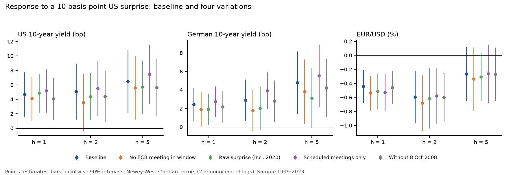

# How much of a Fed surprise reaches euro area markets?

*Enrico Valleri · October 2026 · Code and data: this repository*

**In brief.** Using 201 FOMC announcements between 1999 and 2023, this note
measures how euro area markets react in the days after a US monetary policy
surprise. A 10 basis point tightening surprise raises the German 10-year yield
by about 2.4 basis points by the day after the announcement, roughly half the
response of the US 10-year yield, and the euro loses about 0.4% against the
dollar. Euro area systemic stress does not react in the first days. The
exchange-rate response is robust to every variation tried; the yield response
keeps its sign but is less precisely estimated when windows that also contain
an ECB meeting are excluded.

## Why it matters

When the Federal Reserve surprises markets, euro area financial conditions can
change without any decision by the ECB. Two channels matter for the ECB's
assessment. Higher long-term yields tighten financing conditions for firms and
governments in the euro area. A weaker euro raises import prices. The first
channel works against inflation, the second in its favour, so a Fed surprise
does not move euro area conditions in one clear direction. A large literature
documents that US monetary policy moves asset prices well beyond the United
States (for example Miranda-Agrippino and Rey, 2020). This note asks a narrower
question: how large are the first two channels in the days after an
announcement, measured with a shock that is as clean as current data allow.

## Data and method

The shock is the monetary policy surprise of Bauer and Swanson (2023), updated
by the Federal Reserve Bank of San Francisco: the change in interest rate
futures in a 30-minute window around each FOMC announcement. I use their
orthogonalised version, which removes the part of the surprise that could be
predicted from economic and financial data released before the announcement.
The series is not available for 2020 or for 17 September 2001, which leaves
201 announcements. Its standard deviation is 5.3 basis points.

The responses are daily: the German 10-year yield estimated by the Bundesbank
from the term structure of Federal securities, the ECB reference rate for
EUR/USD, the ECB's composite indicator of systemic stress (CISS), and the US
10-year Treasury yield as a benchmark.

Most FOMC statements are released in the European evening, after that day's
European prices are recorded, so for each announcement I measure the change
from the last observation before the announcement day to the h-th observation
after it. I regress this change on the surprise, one regression per series and
horizon, which is a local projection (Jordà, 2005). Standard errors are
Newey-West with two lags, because announcements that are close in time have
overlapping windows. Conclusions are based on horizons 1, 2 and 5, fixed before
any robustness check was run.

## Results

| Response to a 10 bp tightening surprise | h = 1 | h = 2 | h = 5 |
| --- | ---: | ---: | ---: |
| US 10-year yield (bp) | 4.7 | 5.1 | 6.5 |
| German 10-year yield (bp) | 2.4 | 2.9 | 4.8 |
| EUR/USD (%) | -0.44 | -0.59 | -0.27 |
| CISS (index points) | 0.00 | 0.00 | 0.01 |

*All estimates are significant at the 10% level except EUR/USD at h = 5 and the
CISS at all three horizons. Newey-West standard errors.*

- **Yields.** The German yield rises by 2.4 basis points by the day after the
  announcement, about half the US response of 4.7. The ratio stays close to
  one half over the first four horizons, then moves between about 0.37 and 0.95
  as the estimates become noisier. I report it as a description of the point
  estimates, not as a tested result.
- **Exchange rate.** The euro depreciates by 0.44% by the day after the
  announcement and by 0.59% after two days. After five days the estimate is
  still negative but no longer distinguishable from zero.
- **Stress.** The CISS does not react in the first days. It drifts upwards
  after about three weeks, but that is far from the horizons fixed in advance,
  and with 80 coefficients estimated some will look significant by chance. I
  do not treat it as an effect.

For scale: a surprise of one standard deviation (5.3 basis points) is
associated with a rise of about 1.3 basis points in the German yield and a
depreciation of about 0.2% of the euro by the next day.

## Robustness

I repeat the main horizons in four variations: excluding windows that contain
an ECB Governing Council meeting (27 of 201 at h = 1), using the raw instead
of the orthogonalised surprise (which brings 2020 back), keeping scheduled
meetings only, and dropping 8 October 2008, when the Fed and the ECB cut rates
together.

- **The exchange-rate response is the most robust result.** At h = 1 it ranges
  from -0.44% to -0.54% across the five specifications and is significant in
  all of them.
- **The German yield keeps its sign everywhere** (1.8 to 5.6 basis points), but
  loses significance at h = 2 when windows with an ECB meeting are excluded or
  the raw surprise is used. Part of the baseline response may therefore reflect
  ECB decisions taken the day after the Fed, which happens often.
- **Unscheduled announcements weaken the estimates.** With scheduled meetings
  only, both yield responses are larger and more precise, consistent with
  emergency announcements coinciding with turbulent markets.

## Implications

Fed surprises tighten or loosen euro area long-term financing conditions by
about half as much as they move US conditions, without any ECB action, and they
move the euro in the opposite direction. For the assessment of the euro area
monetary policy stance, this means that part of the change in financial
conditions around FOMC meetings is imported, and that its two components pull
inflation in opposite directions. Which one dominates is not estimated here.

## What this analysis does not show

- **The effect on inflation or activity.** The note measures market prices
  only. The pass-through of the exchange rate and oil prices to euro area
  inflation would need monthly data, and with surprises of a few basis points
  I expect the estimates to be too imprecise to conclude much.
- **The channel behind the yield response.** The estimates do not separate
  expected future short rates from term premia.
- **Intraday reactions.** Daily windows also contain other news, and the
  overlap with ECB meetings is identified by date, not by time of day.
- **Recent years.** The surprise series ends in December 2023, so the
  2024-2025 easing cycle is outside the sample.
- **Same horizon, same day.** Holidays differ between countries, so the same
  horizon can end on different calendar days for German and US yields.

## References

Bauer, M. D. and Swanson, E. T. (2023). A reassessment of monetary policy
surprises and high-frequency identification. *NBER Macroeconomics Annual* 37.

Chavleishvili, S. and Kremer, M. (2023). Measuring systemic financial stress
and its risks for growth. ECB Working Paper 2842.

Jordà, Ò. (2005). Estimation and inference of impulse responses by local
projections. *American Economic Review* 95(1), 161-182.

Miranda-Agrippino, S. and Rey, H. (2020). U.S. monetary policy and the global
financial cycle. *Review of Economic Studies* 87(6), 2754-2776.

Newey, W. K. and West, K. D. (1987). A simple, positive semi-definite,
heteroskedasticity and autocorrelation consistent covariance matrix.
*Econometrica* 55(3), 703-708.
