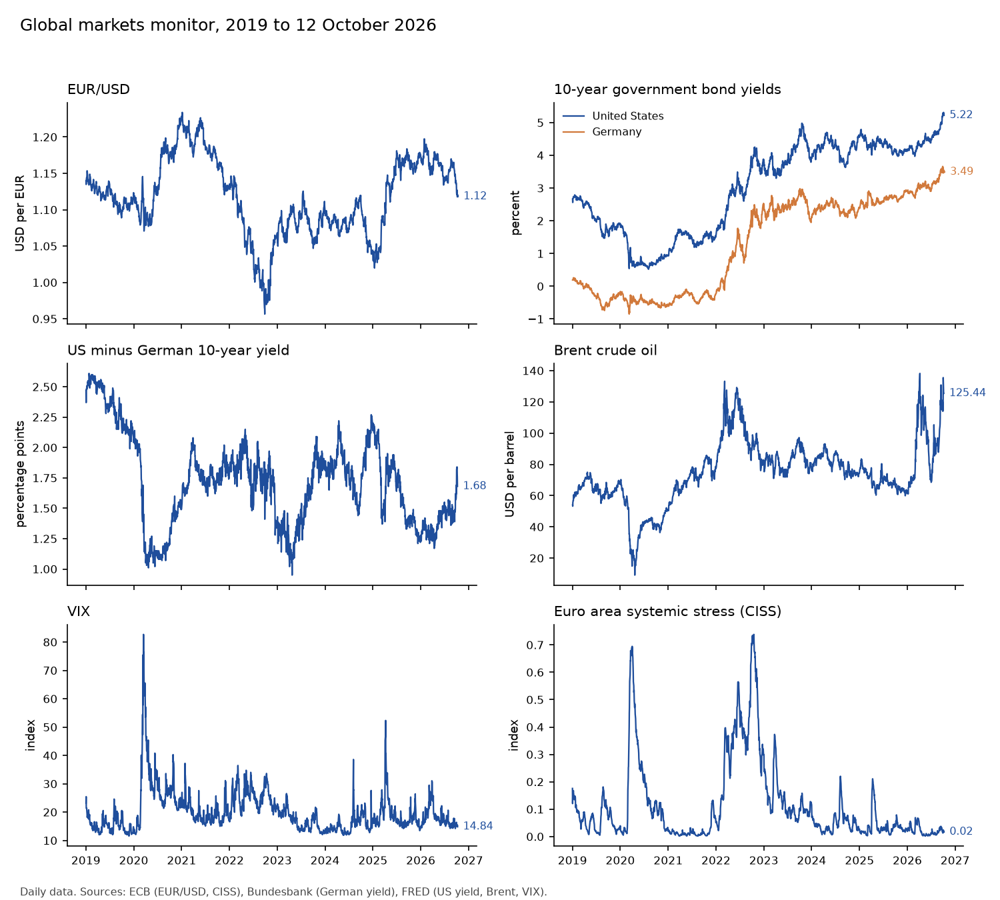

# Global markets monitor

Data downloaded on 2026-10-12. Each series shows its latest observation; the
dates differ because sources publish with different delays. Changes are in
basis points for yields and the spread, in percent for exchange rates and oil
(log changes), and in index points for the VIX and the CISS. The percentile is
the share of daily observations since 1999 below the latest level (since 2006
for the broad dollar index).

| Series | Last date | Level | 1 week | 1 month | 1 year | Change unit | Percentile since 1999 |
| --- | --- | ---: | ---: | ---: | ---: | --- | ---: |
| EUR/USD | 12 Oct 2026 | 1.12 USD per EUR | -0.21 | -3.61 | -3.40 | % | 35 |
| US dollar, broad index | 02 Oct 2026 | 121.38 index | +0.87 | +2.38 | +0.79 | % | 90 |
| US 10-year yield | 08 Oct 2026 | 5.22 % | -2.00 | +42.00 | +109.00 | bp | 92 |
| German 10-year yield | 12 Oct 2026 | 3.49 % | +2.00 | -4.00 | +78.00 | bp | 65 |
| US minus German 10-year yield | 08 Oct 2026 | 1.68 pp | +6.00 | +29.00 | +27.00 | bp | 74 |
| Brent crude oil | 06 Oct 2026 | 125.44 USD per barrel | +9.60 | +20.45 | +62.58 | % | 99 |
| VIX | 09 Oct 2026 | 14.84 index | -0.47 | -1.62 | -1.59 | points | 29 |
| Euro area systemic stress (CISS) | 08 Oct 2026 | 0.0168 index 0-1 | -0.0057 | -0.0055 | -0.0330 | points | 19 |

Rebuild with `make monitor`. To update the data first, run `make download`;
the event-study results in the README and the note would change too.
